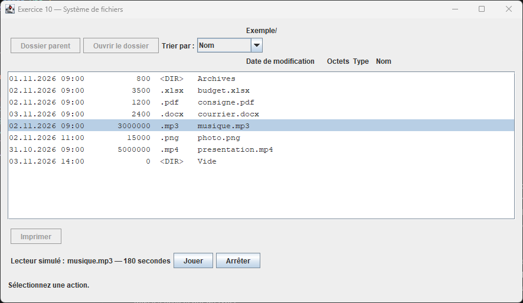
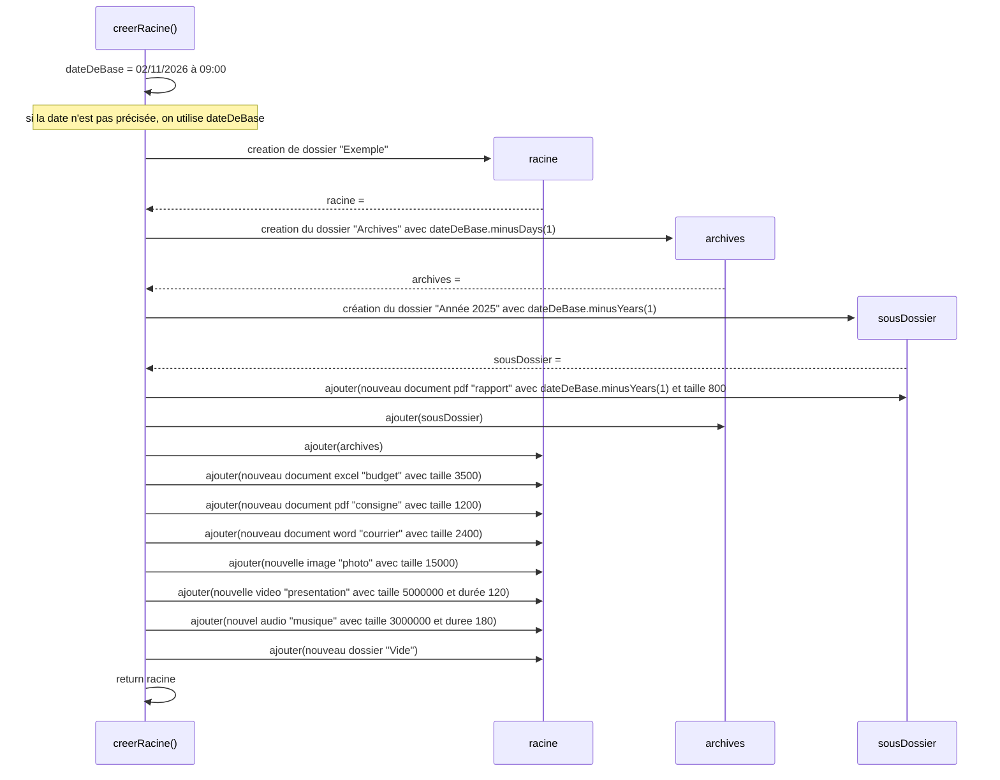

# Exercice 10 — Concevoir un visualiseur de système de fichiers

## Introduction

Vous devez concevoir puis programmer un petit explorateur de fichiers en Swing. Il manipule des objets fictifs fournis au programme : il ne lit pas le disque et n'ouvre aucun document réel.

L'application est en partie fournie. Suivez les étapes décrites ci-dessous pour la compléter.

## Objectifs

- Extraire les classes, les attributs et les interfaces d'une description métier.
- Représenter votre conception dans un diagramme de classes Mermaid.
- Utiliser l'héritage, les classes abstraites et le polymorphisme.
- Mettre en œuvre `Comparable`, `compareTo` et `Comparator`.

## Analyse

Lisez cette description et proposez une conception sous forme d'un diagramme de classe UML.

L'application permet de visualiser un système de fichiers contenant des éléments (des fichiers et / ou des dossiers). Chaque élément possède un nom et une date de modification. On peut demander sa taille en octets. Un fichier mémorise sa taille ; celle d'un dossier est la somme des tailles de son contenu, y compris les sous-dossiers. Un dossier vide a une taille de zéro. Un dossier peut contenir plusieurs fichiers et dossiers ; chaque élément appartient au maximum à un dossier (le contrôleur s'attend à la présence de la méthode `getParent()`).

Plusieurs types de fichiers existent documents, images, audios et vidéos. Les documents peuvent être des tableurs Excel (.xlsx), des documents PDF (.pdf) ou des documents Word (.docx). Les images sont au format PNG (.png). Les audios MP3 (.mp3) et les vidéos MP4 (.mp4) possèdent chacun une durée exprimée en secondes. Les fichiers audio et vidéo peuvent être joués dans l'application. Tous les fichiers ont un type.

Tous les documents et toutes les images peuvent être imprimés. Le contrôleur s'attend donc à l'existence d'une méthodes`imprimer()`. Les audios et les vidéos peuvent être joués et arrêtés, ils ont une durée. Le contrôleur s'attend à l'existence des méthodes `jouer()`, `arreter()` et `getDureeSecondes()`. Un dossier n'est ni imprimable ni jouable. 

L'application reçoit un dossier racine constitué à partir d'une liste d'objets. Elle affiche son contenu immédiat sous forme de lignes de texte (date de modification, taille en octets, type et nom). On peut ouvrir un dossier sélectionné et revenir au dossier parent.

Quand on sélectionne un élément imprimable, le bouton « Imprimer » devient disponible. Pour un média, un petit lecteur contenant son nom, sa durée et des boutons « Jouer » et « Arrêter » apparaît. Pour les autres éléments, le lecteur est masqué. Changer de sélection ou de dossier arrête la simulation en cours.

Par défaut, la liste est triée par nom croissant grâce à l'ordre naturel défini avec `Comparable` et `compareTo`. Deux comparateurs supplémentaires permettent de trier par taille croissante ou par date puis taille croissantes. Dans ce dernier cas, la taille départage uniquement les éléments de même date. Les dossiers participent au tri avec leur taille calculée. Si les critères sont égaux, les éléments restent dans leur ordre d'insertion.

### Travail demandé

1. Relevez les objets métier, leurs propriétés et leurs comportements. 
2. Pour identifier l'héritage: quels éléments ont des caractéristiques en commun? Lesquels sont une spécification d'un autre? Pensez à la phrase **A** est un **B** (comme **Elephant** est un **Animal** -> Elephant hérite d'Animal).
3. Distinguez bien les relations « est un », « contient » et « sait faire ». Pour identifier une interface, la phrase « sait / peut faire » vous aidera.
4. Pensez à ce qui doit être trié, selon quel critère.

## Conception

1. Créez dans un fichier `conception.md` le diagramme de classe (`classDiagram`) Mermaid.Partez d'une classe mère abstraite `Element` et construisez la hiérarchie des classes.
2. Dans les classes, listez les attributs et méthodes nécessaires. Spécifiez sur le diagramme quelles classes et méthodes sont abstraites.
3. Ajoutez les interfaces avec la nomencature correcte.
4. Vérifiez la complétude: classes, interfaces, attributs typés, méthodes, visibilités, héritage, réalisation des interfaces et multiplicités.
5. Faites valider votre conception avant de passer à l'implémentation.

## Implémentation

### Package models
Implémentez les modèles d'après votre diagramme de classes. 

Pour cet exercice, on suppose les données fournies valides : noms non vides, dates non nulles, tailles positives ou nulles et durées strictement positives. La date d'un dossier est fournie explicitement ; ajouter un enfant ne la modifie pas automatiquement. 

### Package views
L'interface Swing simple est fournie.

### Package ctrl
Le contrôleur est partiellement fourni. Reste à faire:
- Compléter les types des attributs selon votre implémentation
- Complétez les tests pour déterminer si les éléments sont imprimables, jouables, ou sont des dossiers (voir marquages TODO, remplacer les if(false))

### Package services
- Complétez les services `ComparateurDatePuisTaille` et `ComparateurTaille` pour avoir le tri correct.
- Complétez DonneesExemples selon le diagramme de séquence ci-dessous pour générer des données d'exemple au démarrage de l'application.

## Vérification

- Les six formats apparaissent avec leur extension.
- Un document ou une image active l'impression et masque le lecteur.
- Un audio ou une vidéo affiche le lecteur et désactive l'impression.
- Un dossier et l'absence de sélection désactivent l'impression et masquent le lecteur.
- La navigation fonctionne, y compris dans un dossier vide.
- Le tri par défaut classe les éléments par nom.
- Les comparateurs par taille et par date puis taille donnent l'ordre attendu ; le tri composé départage les dates identiques par la taille.
- La taille des dossiers inclut les sous-dossiers.

Notez vos conclusions (résultat obtenu pour chaque test).

## Livrables

Votre diagramme Mermaid, votre code Java et une courte description des vérifications effectuées.

